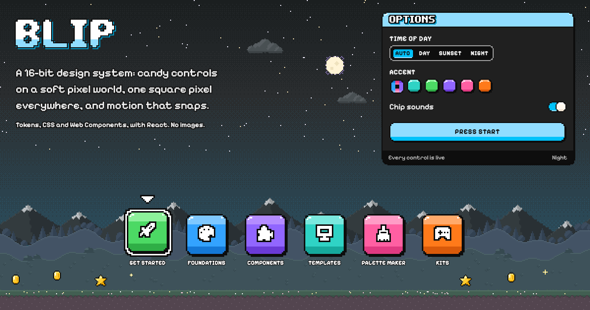

# Blip



**A 16-bit pixel-art design system: candy controls on a soft pixel world, one square pixel everywhere, and motion
that snaps.**

Blip is the tiny pop of a 16-bit sound and a dot of light on a screen.

> **Status: 0.x, not published yet.** Nothing is on npm, the CDN links below will work once it is, and the
> public API can still change between minor versions (see [CONTRACT.md](CONTRACT.md), and
> [Versions and support](https://jaatster.com/blip/versions/) for what stable and beta mean). Until the first release,
> build it from this repository: `pnpm install`, then `pnpm build`.

Blip is one coherent pixel-art world, not a retro costume over a generic kit. Everything you can press is the
same building block, the candy box: a saturated three-tone fill, a one-pixel ink outline with stepped corners,
glints and a one-pixel drop. It stands in front of a soft, dithered landscape whose sky follows the clock, from Day
through Sunset to Night. It has its own display font (Pixel Bop), 189 icons on the same 12 x 12 grid, 53 core
components, kits for game UI, website blocks, effects and sound, and no image files at all.

It is design tokens in the W3C format, plain layered CSS and dependency-free Web Components, with typed React
wrappers on top. It began as the shipped look of an Android TV launcher, where every rule was tested on a box with
1 GB of memory, and it is built for web apps, websites, games and TVs.

[Docs](https://jaatster.com/blip/) · [Design rules](DESIGN.md) · [Public API](CONTRACT.md) ·
[Contributing](CONTRIBUTING.md) · [Authoring rules](AUTHORING.md) · [Storybook](apps/storybook)

## See it

The docs site, [jaatster.com/blip](https://jaatster.com/blip/), is built in Blip itself: every component in Day,
Sunset and Night, the foundations, three templates (a dashboard, a landing page and a game menu) and a theme
builder. Run it locally with `pnpm --filter @blip/docs dev`.

There are no screenshots in this repository on purpose: Blip draws itself. The card at the top is the one
picture, and Blip drew that too: `specimen/press.html` builds it from the system's own parts, and `pnpm shoot`
saves it as the docs site's social preview. The visual tests render every example in all three schemes at 1280 px
wide (and the responsive ones at 390 px) and compare them pixel for pixel:

```sh
pnpm build
pnpm --filter @blip/tests test:visual
```

## Quick start

### HTML, no build step

The files as published and an import map. Paste this into a page, open it, and you have a candy button and working
tabs.

```html
<!doctype html>
<html lang="en">
<head>
  <meta charset="utf-8">
  <meta name="viewport" content="width=device-width, initial-scale=1">
  <link rel="stylesheet" href="https://cdn.jsdelivr.net/npm/@blip/font@0.2.0/font.css">
  <link rel="stylesheet" href="https://cdn.jsdelivr.net/npm/@blip/tokens@0.1.0/dist/css/tokens.css">
  <link rel="stylesheet" href="https://cdn.jsdelivr.net/npm/@blip/core@0.1.0/dist/core.min.css">
  <link rel="stylesheet" href="https://cdn.jsdelivr.net/npm/@blip/components@0.1.0/dist/components.min.css">
  <script type="importmap">
    {
      "imports": {
        "@blip/core": "https://cdn.jsdelivr.net/npm/@blip/core@0.1.0/dist/js/index.js",
        "@blip/elements/": "https://cdn.jsdelivr.net/npm/@blip/elements@0.1.0/dist/"
      }
    }
  </script>
  <script type="module">import "@blip/elements/tabs.js";</script>
</head>
<body>
  <h1 class="blip-display blip-pop" data-scale="3" data-pop="Level 2">Level 2</h1>
  <button class="blip-box blip-button" type="button">Press start</button>
  <button class="blip-box blip-button" type="button" data-variant="soft" data-tone="neutral">Options</button>

  <blip-tabs class="blip-tabs">
    <div class="blip-tabs-list" role="tablist" aria-label="Settings">
      <button class="blip-box blip-tab" role="tab" aria-selected="true">General</button>
      <button class="blip-box blip-tab" role="tab" aria-selected="false" tabindex="-1">Sound</button>
    </div>
    <div class="blip-tabs-panel" role="tabpanel">Music, screen shake, big text.</div>
    <div class="blip-tabs-panel" role="tabpanel" hidden>Chip sounds are off until you turn them on.</div>
  </blip-tabs>
</body>
</html>
```

Add `data-blip-scheme="sunset"` or `"night"` to `<html>` (or to any section) to pin a scheme; with none, the page
follows the device. Add `data-blip-pixel="3"` or `"4"` to make a part of the page chunkier. Until the packages are
published, point the same paths at your own build (`packages/*/dist`, served by `node scripts/serve.mjs`).

### npm

```sh
npm install @blip/font @blip/tokens @blip/core @blip/components
npm install @blip/elements @blip/icons     # behaviour and icons, when a screen needs them
```

```css
/* In this order: the faces, the tokens, the building blocks, the components. Kits after them. */
@import "@blip/font/font.css";
@import "@blip/tokens/tokens.css";
@import "@blip/core/core.css";
@import "@blip/components/components.css";   /* or one file each: @blip/components/button.css */
```

```js
import "@blip/elements/tabs";   // one element at a time, or "@blip/elements" for all of them
```

Every file puts its rules in a cascade layer (`blip.reset`, `blip.tokens`, `blip.base`, `blip.core`, `blip.components`,
`blip.kits`, `blip.utilities`), so your own CSS, outside the layers, wins without `!important`. With Tailwind CSS v4 or
other layered CSS, import `@blip/core/layers.css` first: it puts Tailwind's reset under Blip and its
utilities over it ([Get started](https://jaatster.com/blip/start/#tailwind) has the whole recipe, and notes for Vue and
Svelte).

### React

```sh
npm install @blip/react @blip/font @blip/tokens @blip/core @blip/components
```

```tsx
import "@blip/font/font.css";
import "@blip/tokens/tokens.css";
import "@blip/core/core.css";
import "@blip/components/components.css";
import { Button, Tab, TabList, TabPanel, Tabs, toast } from "@blip/react";

export function Settings() {
  return (
    <Tabs>
      <TabList aria-label="Settings">
        <Tab selected>General</Tab>
        <Tab>Sound</Tab>
      </TabList>
      <TabPanel>
        <Button type="button" onClick={() => toast({ title: "Saved", tone: "success" })}>Save game</Button>
      </TabPanel>
      <TabPanel hidden>Chip sounds are off until you turn them on.</TabPanel>
    </Tabs>
  );
}
```

React 18.3 and 19, on the client and the server. A component like `Settings`, with event handlers, is a Client
Component: in Next.js, put `"use client";` at the top of its file. Kits have their own entry points:
`@blip/react/game`, `/blocks`, `/effects` and `/icons`.

## Packages

Each package has its own version and one entry point per component, so an app takes only what it uses. There are no
runtime dependencies outside `@blip/*` (React is a peer of the React package).

| Package | What it is | Budget, gzipped | Today |
|---|---|---|---|
| **Core** | | | |
| `@blip/tokens` | Every colour, size, duration and type value in the W3C DTCG 2025.10 format, with a resolver for the scheme and the pixel; exported as CSS, JS and TypeScript, Kotlin (Compose), Swift, Android XML and Figma variables | `tokens.css` 4 KB | 3.76 KB |
| `@blip/core` | The building blocks: the pixel, the candy box, type, stepped motion and base styles; `BlipElement`, roving focus, typeahead, dismiss, timelines, the scheme clock and swappable services | CSS 6.5 KB, JS 3 KB | 6.04 KB, 2.88 KB |
| `@blip/components` | The 61 core components as layered CSS, phone ones included: one file, or one per component | 34 KB, all of it | 31.18 KB |
| `@blip/elements` | 22 light-DOM Web Components for the components that need behaviour, with a Custom Elements Manifest | 3 KB each | 1.05 to 3.00 KB |
| `@blip/icons` | 189 icons on a 12 x 12 grid: SVG files, a sprite, JS path data and `<blip-icon>` | 6 KB, all the path data | 5.59 KB |
| `@blip/font` | Pixel Bop, the display face (WOFF2 and TTF), and a Latin subset of Pixelify Sans | Pixel Bop 15 KB (file size) | 8.52 KB |
| `@blip/react` | Typed React components for every component and kit | none: no side effects, one export each | |
| **Kits** | | | |
| `@blip/game` | Game UI: dialogue box, choices, hearts and counters, HUD bars, inventory, button prompts, level tiles, pause menu, achievements, stage and sprites | 3 KB per element | 0.42 to 1.94 KB |
| `@blip/blocks` | Website blocks: hero, features, pricing, call-to-action band, footer | not budgeted yet | 3.67 KB of CSS |
| `@blip/effects` | The world backdrop, page transitions, drop-in and typewriter text, the glint, bursts and a CRT filter; all opt-in | 14 KB, JS and CSS | 13.71 KB |
| `@blip/sound` | Chip sounds synthesised with Web Audio, off until the person turns them on | 3 KB | 1.60 KB |
| **Tooling** | | | |
| `@blip/stylelint-config` | Lint rules that keep CSS inside the system: no raw colours, whole pixels, stepped motion, known tokens | | |

Budgets are enforced by `pnpm budgets` (`scripts/budgets.mjs`), which fails the build when one is exceeded. "Today"
is its measurement on 31 October 2026: gzip -9 in KB of 1024 bytes, except Pixel Bop, whose budget is its WOFF2 file
size. The kits' CSS has no budget yet; measured the same way, the game kit's is 5.78 KB and the blocks' 3.67 KB.
All packages are 0.1.0 except `@blip/font`, which is 0.2.0.

## The rules

Seven rules, kept everywhere. They are why a screen made of Blip parts looks like one world. Each comes with
its reason in [DESIGN.md](DESIGN.md); the build and the lint rules check most of them.

1. **One pixel.** Every outline, icon, letter, corner and movement is a whole number of one square pixel
   (`--blip-pixel`, 2 CSS px by default). Nothing is blurred, rotated or scaled by a fraction.
2. **Ink, never black.** The darkest colour is ink, `#1A1530`, a deep violet: every outline, drop and piece of dark
   text.
3. **Candy on pastel.** Saturated, outlined things can be acted on. The world behind them is soft, dithered and has
   no outlines.
4. **Yellow means focus.** Focus is always the yellow ring with an ink edge, and nothing else is yellow but coins
   and stars. Warnings are orange.
5. **Motion snaps.** Everything moves in two to six even steps, never along an easing curve. With reduced motion it
   is instant.
6. **Disabled is dithered.** A control that is off gets a light checkerboard (the page colour by day, starlight at
   night), not a grey wash.
7. **Light by construction.** No image files: components are CSS, art is SVG, and the world is drawn in the
   browser.

## Browser support

**Baseline 2024 is the floor.** Blip relies on cascade layers, container queries, `:has()`, `@property`,
`round()` and the `popover` attribute, and is tested in Chromium.

Newer features are used where the browser has them, and everything works without them:

- **CSS anchor positioning** places popovers, menus, tooltips and the app bar's folded links; elsewhere menus and
  tooltips are placed by their elements' scripts, and a plain popover opens in the middle of the screen. With
  **anchored container queries** and the opt-in `popover-nub.css`, an open popover's nub turns when it flips.
- **The customisable select** (`appearance: base-select`) turns a native select's picker into a Blip menu;
  elsewhere the browser's own list opens, in the scheme's colours.
- **Invoker commands** (`commandfor` and `command`) open and close dialogs natively; elsewhere `<blip-dialog>` handles
  them.
- **Cross-document view transitions** let the effects kit dither one page into the next; elsewhere pages change
  at once.
- **Typed `attr()`** lets a progress bar fill a whole block at a time; elsewhere it follows the value and the gaps
  still show.
- **Same-document view transitions** run Auto's dither when the time of day changes; without them the scheme
  changes at once.

Most components are CSS on native HTML, so they render before any script runs; elements add behaviour to markup
that already works.

For right-to-left text, set `lang` as well as `dir="rtl"`: Vite 8's CSS minifier rewrites `:dir(rtl)` into a list
of right-to-left languages (`:lang(ar, he, …)`), so in its builds the mirrored rules follow `lang`.

## Accessibility

WCAG 2.2 AA is the floor, and most of it is built in:

- Every text pair the scheme roles make is checked against AA in Day, Sunset and Night when the tokens build, and a
  failing pair fails the build. Labels on candy are ink (white on the dark slate), and every candy's label passes
  AA, on the dither of a disabled control too. Colour never carries meaning alone.
- Focus is always visible: the yellow ring with an ink edge, following the shape of whatever has it.
- Components are native HTML first, and every element follows its WAI-ARIA Authoring Practices pattern, with a
  keyboard path for everything.
- Targets are at least 24 CSS px. Windows high-contrast mode falls back to system colours and real borders, with
  what is on, selected or checked in the system highlight.
- Text follows the browser's default size: the type sizes are in rem, while the pixel grid stays put.
- With `prefers-reduced-motion` every duration is zero and every effect arrives at once. Anything that blinks or
  bobs stops after six beats; toasts pause while pointed at or focused; sound is off until someone turns it on.
- axe scans every example in Day and Night (`pnpm --filter @blip/tests test:a11y`) and every Storybook
  story. In development, elements warn in the console when something lacks a name.

Automated checks are not a guarantee, and Blip has not had an independent accessibility audit yet. If
something does not work with your keyboard, screen reader or settings, please open an issue.

## Licences

- **Code and icons:** MIT ([LICENSE](LICENSE)), Copyright (c) 2026 The Blip authors.
- **Pixel Bop:** SIL Open Font License 1.1, Copyright 2026 The Blip authors, with Reserved Font Name
  "Pixel Bop" ([packages/font/OFL.txt](packages/font/OFL.txt)). Use it, embed it, change it; a changed version may
  not be called Pixel Bop.
- **Pixelify Sans:** SIL Open Font License 1.1, Copyright 2021 The Pixelify Sans Project Authors
  ([github.com/eifetx/Pixelify-Sans](https://github.com/eifetx/Pixelify-Sans)). The font package ships a subset
  ([packages/font/OFL-PixelifySans.txt](packages/font/OFL-PixelifySans.txt)).

The code in the font package (`font.css` and the build script) is MIT, like the rest.

## More

- [DESIGN.md](DESIGN.md): the visual system, its tokens and its rules, for people and for AI agents.
- [CONTRACT.md](CONTRACT.md): the public API that semantic versioning protects, and what stable and beta mean.
- [Versions and support](https://jaatster.com/blip/versions/): versions, deprecation, browser support, changelogs and
  where to get help.
- [CONTRIBUTING.md](CONTRIBUTING.md) and [AUTHORING.md](AUTHORING.md): how to build, test and add to Blip.
- [Storybook](apps/storybook): every example, its states and its tests (`pnpm --filter @blip/storybook dev`,
  then http://localhost:6006).
- [Code of Conduct](CODE_OF_CONDUCT.md) and [security policy](SECURITY.md).
